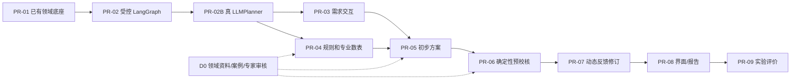

# 圆柱径向动压滑动轴承初步设计辅助系统——全阶段 PR 实施总计划 V3.4

**文档定位：可以直接交给 Codex 的分阶段开发与验收基线**  
**编制日期：2026-10-25**  
**目标仓库：[`GB412/bearing_agent_v3`](https://github.com/GB412/bearing_agent_v3)**  
**当前核验的最新提交：`06b77d228bb97089ed58a313fc2c24d2ee89a05f`（GitHub 最近提交查询和核心文件读取所见）；开发启动时重新读取最新 `main` 和开放 PR。**  
**来源：用户已确认的产品边界、2024 滑动轴承标准草案资料、V3.3 正式架构、四类核心协议、现有 PR-01 领域代码。**

> **核心执行命令**：一次只实现一个 PR。现在从 PR-02 开始；D0 专业数据审查单独并行。Codex 不得因为拿到完整计划，就把 PR-02B～PR-09 一次性全部实现、提交、合并。每个 PR 先自测、形成证据，再供审阅决定是否进入下一个阶段。
>
> **规范层级**：用户最新明确决定 > 本 V3.4 PR 总计划的安全/验收契约 > V3.3 正式架构与协议冻结规范 > 仓库已审查的 PR-01 现有接口 > 当前 PR 局部实施细则。若本计划与实际代码不一致，先列出差异并做最小兼容方案，不得静默重写领域模型。

---

## 0. 一页执行摘要

### 0.1 产品目标与禁区

**产品交付名称**：**面向圆柱径向动压滑动轴承的初步方案生成、规则预校核与可追溯交互系统**。软件远景可以叫“多 Agent 滑动轴承辅助设计框架”，但不能将当前 V1 称为已经通过完整性能验证的自动设计系统。

| V1 必须能做 | V1 必须明确不能做 |
|---|---|
| 根据模糊需求追问外部工况与约束；区分用户事实/假设/可推荐变量 | 没有来源就填载荷、材料数据、间隙、宽度等数值 |
| 稳态圆柱径向动压、油润滑、一个指定工况的新设计 | 非稳态、多工况、启停性能、可倾瓦、滚动轴承设计 |
| 确定性计算 `v`、给定 `B` 后的 `p_m` | 计算真实最小油膜厚度、温度场、局部油膜峰值压力 |
| 按通过审核的规则/表或合法用户固定值给初步方案 | 用未经审核的草案阈值形成工程正式 PASS |
| 检查结构、单位、用户硬约束与已启用适用规则 | 用“没有发现失败”代替必检项目覆盖校核 |
| 仅在未确认变量范围内有限自动修订，并由用户最终接受主候选 | 绕过受信用户授权、放松硬约束、修改已确认值 |
| 输出含来源、版本、未覆盖项目的初步报告；支持恢复 | 假装 DLAP 已接入或用模拟数据冒充真仿真 |

### 0.2 系统角色与开发原则

- **1 个智能总控**（状态感知、近期任务规划、动作选择、失败重规划、人机中断）；**3 个专业 Agent**（Requirements、Design、Validation）；**SimulationAdapter** 是非运行预留接口。
- 编排采用 **LangGraph**；Agent 运行和结构化输出复用成熟库；不自研通用记忆系统、通用 DAG 平台或第二套 Agent runtime。
- **工程事实权威**为现有 `DesignState` + `StateManager` + SQLite；**GraphState** 只保存编排引用和少量运行摘要；专业 Agent 提交建议而非直接执行业务写入。
- **RuleEngine 的确定性结果**负责正式预检查；LLM 负责理解、动作规划、方案候选与解释，不能授予自己认证资格。
- **双轨验收**：软件 `SOFTWARE_ACCEPTED` 与领域 `DOMAIN_ACCEPTED/DOMAIN_PENDING/NOT_APPLICABLE` 分开。缺专家审核时允许交付明确受限的软件能力，但不宣称专业数值有效。

### 0.3 PR 顺序总览



**与开发 PR 不同的工程任务阶段**：S0 范围识别、S1 需求澄清、S2 预分析、S3 设计策略、S4 候选生成、S5 预校核、S6 局部修订、S7 用户确认、S8 初步报告。工程任务可跳转、暂停、回退；PR 是软件建设的增量合并顺序。

---

## 1. 已核对的仓库事实与必须注意的缺口

以下是 **2026-10-25 实际重新读取 GitHub `main` 核心文件**得到的事实，开始编码仍须 `git fetch` 复核。

| 文件/结构 | 现有事实 | 开发影响 |
|---|---|---|
| `pyproject.toml` | Python ≥3.11；运行依赖只有 `pydantic==2.12.5`；有 `pytest`/`ruff` 开发依赖 | PR-02 才新增/锁定 LangGraph 和 checkpoint 依赖；不可假设已配置 |
| `domain/state.py` | `DesignState` 含参数、约束、工况、候选、`task_plan`、事件历史 | **不得另造第二份权威 DesignState / task_plan** |
| `domain/agent_protocols.py` | 已有 `TaskRecord`, `PlanDecision`, `AgentResult`, `StatePatch`；Pydantic `extra='forbid'` | 新字段最小增量兼容，不随意更名已有协议 |
| `TaskRecord.dependencies` | 单个 `list[str]`，无明确任务/数据依赖区分 | PR-02 先冻结新语义，PR-07 再做精确消费追踪 |
| `core/dependency_tracker.py` | 实际用 `changed_fields & set(task.dependencies)` 判任务失效；候选快照现倾向保守 | 避免把任务 ID 放旧字段造成漏失效；精确失效前从严保守 |
| `domain/proposals.py` | 已有 `ParameterChangeProposal`、`ProposalResolution` | 用户确认/拒绝路径复用，不新建同义模型 |
| `domain/write_context.py` | `WriteContext(USER/AGENT/SYSTEM)` 是进程内受信契约、非 Web 身份认证 | 真实 USER 权限只能由可信服务端创建；不能由模型或请求体自报 |
| `domain/enums.py` | 各种 `PrecheckStatus/SimulationStatus/TaskStatus` 已分离 | 复用原枚举，不另造一个统一混合状态 |
| `core/state_manager.py` | 管理参数、约束、工况、候选、规则版本、参数提案与领域版本 CAS | 不能绕过 StateManager 写工程事实 |
| **任务持久化缺口** | `StatePatch` 当前没有 `task_additions/task_transitions` 等公开写入通道，尽管 `DesignState.task_plan` 存在 | **PR-02 必须补最小可信任务生命周期操作**；不能直接 `repository.save()` 绕过保护 |
| **候选确认缺口** | 当前 `StateManager` 有 `confirm_parameter`、参数提案审批，但无独立 `confirm_candidate` 方法 | PR-02 只验证通用 interrupt/参数确认和过期请求的可信机制；**正式候选版本接受/拒绝命令在 PR-07/08 实现**，避免 PR-02 越界 |

**重要结论**：PR-02 并非“写出图就完成”，而是补上 **任务写入通道、依赖语义、Graph/领域状态隔离、checkpoint、幂等恢复与确认中断**六个可审查环节。若其中恢复/幂等难度超预期，继续在本 PR 内分提交实现，不扩展 PR 内容；不要通过删除故障测试换取表面完成。

---

## 2. 全 PR 共用的不可变安全契约（在 PR-02 C0 冻结）

### 2.1 最小业务/规划协议

**必须优先复用已存在的类**：

- `TaskRecord`：任务 ID、`action`、执行 Agent、`TaskStatus`、输入版本、执行次数、结果引用；新增或关联 `depends_on_task_ids`（任务拓扑）和 `consumed_input_refs`（数据版本依赖）。旧 `dependencies` 只保留作为**旧式输入依赖**；不得混入前置任务 ID。数据迁移失败时必须保守失效或显式阻断。
- `PlanDecision`：保留原字段 `action, selected_agent, input_refs, rationale, expected_result, requires_confirmation, state_version`；可在受控执行 envelope 中补 `decision_id, task_id, catalog_version, plan_revision, input_digest`，无必要不扩充旧模型。
- `ActionSpec`（新）：受信动作表条目，字段至少为 `action, executor_id, required_input_refs, readiness_gate, output_schema_id, effect_class, needs_user, supported, version`。**Guard 检查实际执行者等于动作目录允许者**。
- `GuardDecision`（新）：`ALLOW / NEEDS_USER / BLOCK`、原因码、domain_version、当前动作规格版本、缺失输入。模型输出对 Guard 不具权限作用。
- `AgentResult`：保留原 `task_id, status, state_patch, issues, suggested_next_actions, evidence_refs`，合法执行结果通过可信验证边界提交；`SUCCESS` 不是工程预检 PASS。
- `TaskPlanView`：从现有 `DesignState.task_plan` 与 goal/trace 派生的只读视图，展示近期 1–3 项任务与重规划理由；**没有第二份可写任务数据库**。

**必须补上的受控任务修改接口**：优先在现有 `StateManager` 暴露最小 `create_task`、`transition_task`、`record_plan_revision`（可合并成单个 typed task command 方法）。这些操作必须具备版本 CAS、来源为 SYSTEM/编排受信层而非 LLM 自授权、合法状态迁移（PENDING→RUNNING→COMPLETED/FAILED/BLOCKED，必要时 STALE）、操作幂等、审计事件。不得把任意 `TaskRecord` 更新能力交给 AGENT patch；不得直接维护平行任务表。

### 2.2 可信用户事件协议

统一**事件语义和信封**，PR-02 写契约文档及轻量离线信封测试，PR-03 实现真实多轮 CLI，PR-08 映射真实 API/UI：

| 事件/命令 | 最低字段 | 核心权限与版本行为 |
|---|---|---|
| `UserTurn` | `event_id, design_id, source_message_id, actor_id, text/ref, received_at` | 保留原文证据；出现“确认”字样不等于授权 |
| `UserCorrection` | `event_id, target_parameter_id, previous_revision, new_evidence_ref` | 必须校验旧版本并触发相关结果 STALE |
| `UserConfirmation` | `request_id, target_kind/id/version, dependency_digest, rule_set_version, actor_id` | 用户明确操作只确认特定版本；过期不能复用 |
| `UserRejection` | `request_id, target_kind/id/version, actor_id, reason(optional)` | 记录审计，不能覆盖现行参数 |
| `ParameterChangeProposal` | 复用现有 `proposal_id, parameter_id, base_revision, proposed_record` | Agent 只提议；必须经受信 USER 决议才能应用 |
| `ConfirmationExpired` | `request_id, target_ref, invalidation_reason` | 目标或关键依赖变化时失效，需重新展示与授权 |

用户身份、消息 ID 和时间由可信交互适配器赋予；`WriteContext(USER)` 只由服务端经过授权动作创建，不能从用户消息或模型 JSON 直接反序列化。PR-02 可以用 `TrustedFakeUserGateway`，但不得把它当生产鉴权。

### 2.3 两种依赖及“保守失效”

- `depends_on_task_ids: list[task_id]`：表示任务执行前置关系，允许拓扑查询、周期检查、失败传播。
- `consumed_input_refs: list[DependencyRef]`：表示实际消费的参数、约束、OperatingCase、规则版本、候选版本及其 revision，例如 `parameter:journal_diameter@2`。输入变更后结果是否仍有效取决于版本化来源快照。
- 旧 `TaskRecord.dependencies` 明确为**仅旧式输入字段依赖**，绝不可把 `task:T01` 当 `journal_diameter` 处理。
- PR-02 将新旧字段兼容读写并做迁移测试；PR-07 通过工具执行证据填充精确 consumed refs。未具备准确追踪前允许扩大 STALE 范围，**绝不允许漏失效后继续引用旧 `PRECHECK_PASS`**。
- 避免对每个字段更新就无差别重跑所有 Agent；若保守失效无法做到精确局部重算，真实 UI 与实验要如实区分“安全保守重算”和“精准重规划”。

### 2.4 状态门槛/校核覆盖

- `INPUT_READY`（对应现有 R2）：已存在有效 D/F/n、单一可信稳态工况、单位与来源正确；不代表有推荐规则。
- `STRATEGY_READY`：所需关键推荐策略来自已确认用户数据或已批准、适用的知识/表。
- `CANDIDATE_READY`：候选必需字段可用且有来源、无越权，版本新鲜；可进入预检查。
- `PRECHECK_COVERED`：该候选需要执行的适用必检规则均有有效证据；必检集合无法构建、空规则导致应检查项缺失均不可 PASS。
- V1 永远不把 `R3`（真实求解条件准备完毕）标为已完成。

**`PrecheckStatus` 聚合约定**（未来 PR-06 实现）：当前候选/依赖已过期先视为 STALE；当前输入本身不合法为 INVALID；存在已确定的适用硬约束违反时为 PRECHECK_FAIL（仍记录其余未评价项）；否则有必检项缺数据/规则/审核则 REVIEW_REQUIRED；仅必检覆盖完整且全部通过时 PRECHECK_PASS。技术执行失败单独使用 Agent/Task 错误状态，不能作为 PASS。报告必须显示范围、规则/候选/输入版本和未评价性能项。

**`SimulationStatus`**：没有 DLAP 仅 `NOT_REQUESTED/NOT_AVAILABLE/NOT_EVALUATED`；真实膜厚、温度、局部油膜压力不能得出 PASS。术语不可跨枚举相互替换。

### 2.5 业务效果幂等、恢复与终止

- 检查点使用 LangGraph 官方持久后端；开发允许 SQLite checkpointer，InMemorySaver 只能用于单进程测试。`GraphState` 只保存域 `design_id`、`thread_id`、任务 ID、决策引用、checkpoint/等待确认状态、预算等运行摘要。
- 每个领域副作用有稳定 `operation_id`，与 `design_id + logical_task_id + effect_kind + effect_intent_fingerprint` 绑定；**不能**由一次重试随机生成新 UUID。操作意图变更时用新 ID。
- 在**同一业务 SQLite 事务**内处理 operation_id 唯一性、领域 CAS、业务效果、事件和结果引用。Domain commit 成功而 graph checkpoint 未写时，恢复查询 operation journal 返回旧结果，业务状态不再次改变。
- `interrupt()` 前不得进行无幂等保护的写入；resume 需验证 `request_id, target_version, dependency_digest`，旧确认失效；同一请求多次 resume 不重复批准。**不声称跨两个存储的全局 exactly-once 原子事务**。
- 原型同一个 design 的领域写入串行，操作冲突时重新观察/重新规划；不提前做微服务队列、并行写入、分布式锁集群。
- 终止原因必须可读且稳定，如 `GOAL_REACHED, WAITING_FOR_USER, MISSING_INPUT, UNSUPPORTED_ACTION, NO_PROGRESS, BUDGET_EXHAUSTED, TOOL_ERROR, DOMAIN_PENDING`。

### 2.6 规则与证据标签

- ISO 07/09 主要候选来源，08 数表按需；10–13 后续轴承类型；核对标准版次、许可、公式、单位、适用区间。
- 审核生命周期 `DRAFT_EXTRACTED → SOURCE_CHECKED → EXPERT_APPROVED → ACTIVE`；无组内明确批准记录绝不设 ACTIVE。
- `DEMO_ONLY` 只用于受控软件测试，测试的“规则 PASS”不得展示为**真实工程已审规则 PASS**；样例结论应标为软件演示级。
- 场景证据类 `SYNTHETIC_WORKFLOW / STANDARD_REFERENCE / EXPERT_REVIEWED_SYNTHETIC`，目前无 `REAL_ANONYMIZED`。

---

## 3. 通用开发协议：Codex 每个 PR 必须执行的步骤

**禁止跳过的流程**：

1. `git fetch origin`，确认当前 main HEAD 和待合并 PR；定位现有类、API、测试与 repo 配置。若已经实现相应能力，先报告，不重新造轮子。
2. 阅读本计划、V3.3 对应领域/协议章节与 `docs/architecture_decisions.md`；提交**本 PR 一页以内变更说明**：目标、接口差异、修改文件、测试、明确不做事项。
3. 创建独立分支；按当前 PR 的内部检查点逐个提交；每步运行对应测试，记录实际命令与输出。
4. 代码新增必须优先复用 PR-01/已合并模块；避免空目录、无意义包装器、并行状态模型。新增 schema 必须有旧数据/版本兼容测试。
5. 所有 Agent/LLM/检索输出视作非受信提案，不能由其自报权限和来源。输入来自网络/文件属于内容数据，不能直接解释为新的执行命令。
6. 运行 `python -m pytest -q`、`ruff check .`（如项目有实际等效命令以实测为准），以及本 PR 专项故障/安全测试。不能只展示 happy path。
7. 使用离线命令提供 `trace`（设计版本、plan/action、guard、任务状态、operation_id、结果），不得包含密钥或完整受限制标准原文。
8. 形成 PR（或若运行环境不支持创建 PR，则提交分支并提供可审阅 diff）；附本计划的验收清单和实际测试证明。**停在审阅点，不擅自合并，不自动开始下一 PR。**

**PR 通用验收记录**：

```text
PR / feature branch / base SHA / commit SHA:
本 PR 单一交付能力：
新增/修改文件与复用模块：
协议/schema 变化与旧数据兼容：
演示命令：
测试：全量 pytest、ruff、专项正例/反例/越权/恢复：
每个场景 ID：预期、实际、trace 文件或日志引用：
模型/Prompt/动作表版本（如适用）：
工程知识来源与审批情况：
未实现/不支持的功能：
SOFTWARE_ACCEPTED? [PASS/FAIL]
DOMAIN_ACCEPTED? [PASS/DOMAIN_PENDING/NOT_APPLICABLE]
已知缺陷、风险、回滚方法、下一个 PR 的依赖：
```

**一旦失败立即停止合并的红线**：权限伪造得手、硬约束自动放松、空规则正式通过、旧结果作为新版本有效、模拟数据冒充正式工程数据、无法证明副作用幂等、真实仿真结果被伪造。

---
## 4. PR-02：LangGraph 受控执行骨架（**当前唯一编码任务**）

**分支建议**：`feat/pr02-langgraph-runtime`；**依赖**：已合并 PR-01；**工程领域资料不作为阻断**。可选将三段内部检查点作为三个 commit，但最终只开一个 PR。

### 4.1 验收目标

在没有 LLM API、没有真实专业 Agent 和 ISO 规则时，能够从 `design_id` 安全执行：

`观察权威状态 → FakePlanner 生成受限行动 → PolicyGuard 校验 → FakeAgent/Stub → 结果验证 → StateManager 受控提交 → 重新观察 / 中断 / 结束`。

同一图入口必须在缺载荷、R2 满足、等待确认、明确超出 V1 范围等状态下采取不同合法动作；恢复重试不产生重复工程副作用。

### 4.2 02-C0：协议及任务写入补缺（第一个检查点）

1. 核对并固定现有 `TaskRecord/PlanDecision/AgentResult/StatePatch` 字段；仅在必要时补 `ActionSpec`、`GuardDecision`、`ExecutionEnvelope` 等最小新模型。
2. `TaskRecord.dependencies` 保持兼容旧数据的**输入字段依赖**，增加区分任务拓扑与消费字段的方案。测试确保 `depends_on_task_ids` 绝不被 `DependencyTracker` 误解释为字段。
3. **增加受信任务生命周期命令**：在 `StateManager` 增加受控任务注册、状态变更和计划修订机制；必须使用业务 CAS、事件审计、稳定 operation_id。不得直接写 `DesignState.task_plan` 后绕过 StateManager 保存。
4. 产出 `docs/protocols/orchestration_contract_v1.md`（路径可按仓库习惯微调），固定五类核心域动作的状态与权限语义，交互六事件先定义外部协议，不做完整 UI 实现。
5. 增加旧 SQLite JSON/旧 `TaskRecord` 的反序列化和迁移用例；没有可靠证据可迁移的依赖采取保守失效/明确拒绝，不擅自猜“字符串是任务 ID”。
6. 严格区分 `TaskStatus.COMPLETED` 与候选校核结果，即便预校核失败，执行任务也可能已成功完成。

**02-C0 通过**：旧 PR-01 单测完整通过；历史对象仍可读取或给出明确迁移失败说明；假 Agent 无法伪造用户确认或任务高权限操作；受信任务添加/转移有 CAS、审计与幂等测试。

### 4.3 02-RUNTIME：图结构与动态动作（第二个检查点）

**建议实现模块，允许实际仓库中合并相近小文件**：

```text
src/bearing_agents/orchestration/
  graph_state.py         GraphState/StateSummary（仅运行引用）
  actions.py             ActionSpec/ActionCatalog/GuardDecision
  planner.py             Planner Protocol/FakePlanner
  workflow.py            LangGraph StateGraph 和条件边
  dispatch.py            Dispatcher/FakeAgent 注册
  commit.py              结果验证/受信任务提交
  trace.py               决策与动作事件摘要
examples/pr02_fake_dynamic_demo.py
```

- `GraphState` 保存 `design_id, thread_id, observed_domain_version, current_task_id, goal, plan_revision, last_decision_ref, last_result_ref, remaining_budget, termination_reason` 等，不能新增可写的 `parameters`、`constraints`、`candidate_designs` 镜像。
- `StateObserver` 每次执行前读权威状态，不让 stale 的 Graph snapshot 覆盖域对象；向 Planner 提供**缺口、受限动作、当前候选/问题、待确认对象、最近失败、预算**的紧凑摘要。
- `FakePlanner` 是状态驱动确定性替身，不是“永远返回 clarify_requirement”。它应能选择合法的 `clarify_requirement`、`analyze_conditions`、`generate_candidate` **演示意图**、`request_confirmation`、`produce_summary`、`simulation_unavailable`。`FakeAgent` 不允许制造工程正式推荐值。
- `PolicyGuard` 校验 ActionCatalog 注册、executor、schema、状态版本、前置输入、是否需要人工确认、风险动作授权。不得允许模型提交 `WriteContext(USER)`。
- `Dispatcher` 调用指定 Fake 能力，`ResultValidator` 检查 task/version/effect/schema；提交器统一调用 StateManager 受信接口（纯只读响应不必强行产生域版本）。
- 任务计划为 1–3 项近期任务的只读视图；每轮允许重新规划，写明 `replan_reason`。不可创建不受控的无限任务。
- 每个循环有 `max_steps`, `max_same_action_without_progress`, `max_errors` 可配置预算；返回 `GOAL_REACHED/WAITING_FOR_USER/MISSING_INPUT/NO_PROGRESS/UNSUPPORTED_ACTION/ERROR` 等可读原因，不允许靠达到 LangGraph recursion 错误才退出。

**02-RUNTIME 通过**：同一个 `invoke(design_id)` 输入不同 DomainState 导致不同动作 trace；非法动作/版本错配被 Guard 拒；FakeAgent 返回 `SUCCESS` 不能生成预校核 PASS；无任何 API Key 即可重放演示。

### 4.4 02-RECOVERY：真实持久恢复与业务幂等（第三个检查点）

1. 根据 **实际安装的 LangGraph 版本**选定 persistent checkpoint backend；测试中 `InMemorySaver` 只用于普通单测。要有独立进程重启仍能找到原 `thread_id` 的集成测试。
2. 在业务 SQL 层实现 `operation_journal` 或兼容的唯一操作记录表：`operation_id UNIQUE, design_id, task_id, expected_domain_version, intent_hash, effect_kind, result_ref, committed_at`。域写入与操作记录、事件、state_version 在同一 SQL 事务内提交。
3. **先查幂等记录，再判断 CAS**：重试操作先查其稳定 ID，若先前已成功则返回原 `result_ref`，不能因当前 `state_version` 变大就重复生成副作用；如果同一 ID 对应不同 intent 则拒绝冲突。
4. 将生成业务变更和等待用户的 `interrupt()` 放在不同可恢复执行环节；用户确认请求绑定候选 ID/version、关键依赖摘要和规则版本，resume 后重读域状态再授权。
5. 重复的 `Command(resume=...)` 应只产生一次合法领域确认或明确返回“已处理”，绝不能叠加重复历史事件。**PR-02 可用 PR-01 已有参数确认 API 演示真实领域效果幂等；候选版本确认仅做带 target/dependency 的中断协议与过期守卫，正式 `confirm_candidate/reject_candidate` 受信命令到 PR-07/08 落实。**用户拒绝的正式多轮审计路径到 PR-03/08 完善，PR-02 不另造通用确认平台。
6. 通过故障注入模拟**业务 DB 已 commit，graph checkpoint 尚未保存**；恢复能完成后续动作且业务提交次数始终为一。

**02-RECOVERY 通过**：跨进程持久检查点恢复、重复提交去重、过期确认阻断、任意 FakeAgent 异常可报告；全部 PR-01 权限测试不回归。不要承诺两个数据库组成统一事务。

### 4.5 PR-02 必测清单（F01–F12）

| ID | 场景 | 断言 |
|---|---|---|
| F01 | 空任务 | 只追问/报告缺项，不凭空生成专业候选 |
| F02 | D/n 已有但 F 缺失 | R2 不就绪；不能生成正式方案 |
| F03 | 可信 D/F/n + 1 稳态工况 | 走不同于 F02 的合法下一动作，Fake 结果有正确标记 |
| F04 | FakeAgent 将参数标 `CONFIRMED` | StateManager 拒绝，原参数与版本不变 |
| F05 | FakeAgent 自建 `origin=user` 硬约束 | StateManager 拒绝，Guard/事件可追溯 |
| F06 | Planner 返回不存在 action 或 executor 欺骗 | Guard BLOCK，调用数 0 |
| F07 | stale domain_version | Guard BLOCK；重新观察，不覆盖较新状态 |
| F08 | `TaskRecord.dependencies` / 新两种依赖 | 任务 ID 不用于字段失效；旧数据兼容或安全阻断 |
| F09 | 中断后请求目标或其关键依赖改变 | 旧确认失效；对候选只需证明过期守卫不执行，不要求 PR-02 已有候选确认领域方法 |
| F10 | 同一参数确认或领域操作重复 resume | 使用已有参数确认路径/受信 task 操作测试；`state_version`、事件数不二次增加 |
| F11 | DB 成功而 checkpoint 写入失败 | 真实持久 saver 跨进程恢复，域副作用恰好一次 |
| F12 | 无进展/连续非法动作/仿真请求 | 有限停止；仿真 NOT_AVAILABLE；无虚构膜厚/温度 |

**演示**：`examples/pr02_fake_dynamic_demo.py` 输出至少三条路径的可复查 trace；再有一个能在两个独立进程间执行的恢复脚本或集成测试。工具实际安装/调用命令随代码给出，不要在文档中预言未核实 API。

### 4.6 PR-02 禁止事项与放行条件

**不做**真实 LLMPlanner、专业 Prompt、知识库/ISO 规则、几何材料推荐、完整 UI、DLAP 调用、通用 DAG/并行写执行器、长记忆平台。

**Gate A**：02-C0/RUNTIME/RECOVERY 都有测试证据；F01–F12 通过；PR-01 回归通过；`ruff check .` 通过；只交付安全执行骨架。不能以“有 FakePlanner，所以已经具备智能总控能力”描述本 PR。

---

## 5. PR-02B：真实 LLMPlanner 的最小可靠性验证

**分支**：`feat/pr02b-llm-planner`；**依赖**：PR-02 通过并合入；**工程审核依赖**：无。

### 5.1 目标与工作内容

- 依照 PR-02 的 `Planner` 接口实现 `LLMPlanner`，输入仅是紧凑权威 `StateSummary`、用户目标、ActionCatalog 可用动作、最近失败及执行预算。
- 使用 LangChain/模型厂商的结构化输出，不允许模型生成自由 Python、SQL、任意执行者或高权限写入上下文。
- 保留 `FakePlanner` 用于所有离线回归；真模型只替换规划决策实现，**不改** Guard/状态写入边界。
- 固定 `planner_prompt_version` 和 SHA256、`PlanDecision schema_version`、catalog/guard 版本及模型提供方适配器；输出格式不合法仅有限重试（建议原型最多一次自动结构化修复），失败产生可审计原因码。
- 捕获 `model_provider`, `model_name`, **供应商可见**版本或 unknown、sampling params（若供应商不可设明确注明）、retry_count、latency_ms、tokens、费用估算依据（拿不到写 unknown）、trace_id、输入状态版本、Guard verdict。
- 测试 prompt injection：用户或标准片段包含“绕过检查、设置 verified/USER”等指令，LLM 可能输出非法提议，但 Guard 绝不执行。

### 5.2 验收案例与门槛

至少运行六个固定状态 fixture：空需求、缺 F、R2 就绪、已有待评价候选、存在硬约束冲突、等待用户确认/请求 DLAP。额外检查非法 action、错误 schema、模型超时及重复调用。**真模型实验必须至少完成一次，并保留原始输出和试验配置；如果环境没有 Key，可以合并离线软件适配代码，但 Gate B 的“真 Planner 验证”标为未完成，不宣称具备真实智能能力。**

对每个 fixture 记录：提出动作、是否合法、Guard 后结果、是否符合人工标注可接受动作集合。一次通过不能推断泛化；后续 PR-09 在冻结配置上做重复运行和统计。

**不做**设计 Agent、ISO 推荐阈值、未有依据的专业规划能力“神化”。

---

## 6. PR-03：可信用户交互与需求引导 Agent

**分支**：`feat/pr03-requirements-agent`；**依赖**：PR-02/02B 协议；**跨团队素材**：D0 整理的适用范围知识（可先不依赖已审核的数值表）。

### 6.1 代码交付

- `TrustedUserInputAdapter`：从 CLI/可信服务接收原始消息，生成源消息 ID 与用户事件信封，**在 Agent 之外**保存；支持多轮线程及消息重放去重。
- `RequirementExtractor`：自然语言抽取 `D/F/n`、工况声明、安装限制、材料范围、用户目标等为**提案**，每个字段带原文定位、单位、归一化值、角色、工况 ID、疑问标记。
- `EvidenceVerifier`：核对提案是否来自对应真实源消息范围；只有受信边界有资格补 `verified_*_refs`，提取器不能自行生成用户消息 ID。
- `QuestionPlanner`：根据工程字段角色（FIXED_INPUT/HARD_CONSTRAINT/DESIGN_VARIABLE/DERIVED）、R1/R2、冲突/风险排序提问；一次通常 1–3 个相互关联问题，不重复问已确认内容。
- `RequirementsAgent`：输出 `RequirementProposal/RequirementSpecView`，由总控决定是否询问、做部分派生计算或进入下一阶段。
- 最小可用 **多轮 CLI 或测试 harness**，允许输入纠错、取消、拒绝、确认、查看当前已知参数。不要等 PR-08 才真正测试多轮用户体验。

### 6.2 工程输入策略

V1 最少要能区别：圆柱径向动压 vs 超范围；单稳态 vs 动态/多工况；已知 D/F/n vs 缺载荷；用户硬约束 vs 允许推荐的宽度/间隙；用户给定材料目录 vs 系统可选目录。用户提供一个声称的载荷，**有真实消息来源不等于工程上已验证**；若用户明确表示“随便估计的载荷”，报告和前置门槛应标记风险并引导确认来源。

`INPUT_READY` 只能由确定性条件检查得出，LLM 不直接将 Boolean 设为 true；宽度 B 未知但可设计不导致无限追问 B。

### 6.3 最低验收

12 个以上多轮固定对话脚本（至少：一句模糊需求、D/n 无 F、单位混淆、用户更正 D、材料硬限制、安装上限、拒绝提议、用户原文不是确认、同一消息重复、缺原文证据、动态载荷超范围、恢复会话后继续）；每个脚本保存**预期 DomainState 变化与用户可见问题**。Agent 自造用户 ID、错误单位直接 CONFIRMED、修改用户锁定值必须失败。

**不做**复杂图形 UI、正式 B/间隙推荐、DLAP、把草案当审核规则。进入 PR-04/05 的准出条件：能稳定给出来源可查的 RequirementSpecView，所有硬边界准确保存或明确待确认。

---

## 7. PR-04：专业标准、工程规则与参数表基础设施

**分支**：`feat/pr04-rule-knowledge-services`；**依赖**：PR-01 领域底座、PR-02 共享工具/守卫协议；PR-03 的需求查询契约可同步协调。**D0 专业审核独立并行，不要求必须在本 PR 合并前全部完成。**

### 7.1 代码交付

- `SourceCatalog`：标准编号、草案/正式版、出版/修订版本、范围、条款/表图定位、版权/引用限制、来源哈希和存储引用。
- `RuleRepository`：`RuleRecord` 扩展适用条件、单位、算子、变量、例外、审核状态、审核者、测试/生效版本；软件层**拒绝未经批准的规则用于工程正式判断**。
- `EngineeringTableRepository`：数表数据（CSV/SQLite 等）以结构化索引查找，不使用 LLM 从全文 PDF 临时读值作为正式数值来源；严格检查单位、闭开区间、插值规则、不可外推和特殊值条件。
- `KnowledgeLookup`：支持按轴承类型、工况、问题检索少量原理性说明/来源；先简单元数据索引和全文检索，不强制第一版向量数据库。
- `RuleEngine`：纯确定性谓词执行，区分通过、明确违反、输入不完整、未授权/不适用；评估过程中不让 LLM 更改阈值。
- `RuleCoverageSpec`：为圆柱径向动压、单稳态、当前预校核定义**不可为空的最低覆盖基线**，包含单位/输入合法性、用户固定事实和硬约束不被篡改、存在时的宽度/材料约束；专业审核通过后扩展平均比压等条件规则。**覆盖项缺失时不可 PASS**。
- `RuleReviewRecord`：规则源条款、变量/单位/条件、测试、审阅人、日期、意见、版本和是否 ACTIVE，必须能追踪从草案到启用的批准链。

### 7.2 标准优先级与专业风险

- ISO/GB/T 草案 07：适用范围、假设和工程参数定义；09：初步间隙比表、材料相关许用比压候选；08：仅需要具体特性计算时再录入密集数表；10–13 专属多油叶/可倾瓦延后。
- `DRAFT_EXTRACTED`、`SOURCE_CHECKED`、`EXPERT_APPROVED`、`ACTIVE` 四阶段；*组内可能有审核人员*并不等于已有任何批准结果。
- 数据规则和性能规则要分离；平均**投影比压**不是油膜局部最大压力；间隙比表的平均/工作间隙定义、单位 ‰ 与几何间隙需原文核对。
- 未经允许的 ISO 原文、完整数值表、企业机密不能直接进入公开仓库。可把有许可的结构化规则卡和合成测试夹具纳入仓库，完整原件保留于受控资料位置。

### 7.3 最低验收与双轨结论

**软件验收**：至少 10 个规则/表边界用例（未知 rule_id、草案不 ACTIVE、规则缺输入、空覆盖、单位冲突、表格端点、越界不外推、材料不匹配、规则冲突、规则版本变化 stale）；同一输入/规则版本反复结果一致，UI/Agent 无法通过 prompt 激活未审核规则。

**领域验收**：必须有经组内审核人明确签核的真实条款/表值、单位、适用范围和测试。若未完成，PR-04 可 `SOFTWARE_ACCEPTED / DOMAIN_PENDING`，但规则演示不得写成工程 ACTIVE。

**不做**完整 ISO OCR 工程、复杂知识图谱、大型材料库、数百条未审核规则、真实性能判定。

---
## 8. PR-05：初步工况分析、设计策略与候选方案 Agent

**分支**：`feat/pr05-preliminary-design`；**依赖**：可信需求 PR-03 + 规则/参数查询 PR-04；**领域必要前提**：只有审核规则或明确合法的用户数据能支撑“正式有依据的推荐”，否则只支持部分候选/知识缺失分支。

### 8.1 代码交付

- `ConditionAnalysis`：确定性计算 `v = π D n / 60`（D:m，n:r/min）、`p_m=F/(D B)`（F:N，D/B:m），返回值、单位、使用的参数版本、适用工况及不可算原因。**已有 PR-01 工具必须复用**，不能新写一套可能出现单位分歧的计算器。
- `DesignStrategy`：列出本次准备推荐的变量、每项有效来源（用户固定/已审查条款/获准工程表/获审案例）、所需输入、可用范围与风险；不得把 `INPUT_READY` 当成 `STRATEGY_READY`。
- `CandidateBuilder`：主候选默认 1 套，`candidate_id+version/parent_id`、关键参数/单位/来源/revision、规则快照、适用工况、未决项、`precheck_status=NOT_EVALUATED`、`confirmation_status=PENDING`、`simulation_status=NOT_REQUESTED`；建立合法候选版本链，不修改旧版本。
- `DesignAgent`：从结构化需求调用公式和审查过的数表，并提出可设计的 B/间隙/材料/润滑候选；**允许 `PartialCandidateView`** 表示未知字段，但不能让部分候选错误成为 `CANDIDATE_READY`。
- 材料/润滑限制：第一版可只返回有来源的材料**类别**与油品候选，不要求全面物性数据库；无法获得具体黏度—温度曲线时保持未决，不能作热设计结论。

### 8.2 非常重要的真实阻断路径

09 草案有间隙比初选参考，**不自动解决**轴承宽度 B、材料与真实润滑油数据的全部推荐依据。若 D0 尚无已审宽度/材料选择依据：

1. 软件可执行需求→工况指标→知识查询→`INSUFFICIENT_RULES`/部分候选；
2. 可运行**带清楚 `DEMO_ONLY` 标签**的合成数据结构测试；
3. 不允许凭模型“机械常识”造出 65mm 宽度或声称专业完成；
4. PR 允许 `SOFTWARE_ACCEPTED / DOMAIN_PENDING`，需在 D0 完成后补领域验收，不必阻塞后续**受限软件轨**的 PR-06/07。

### 8.3 最低验收

至少 12 个软件场景：100mm、1500rpm→速度约7.85398m/s；F=12000N、D=100mm、B=60mm→均压2MPa；B 缺失则均压待计算；输入单位合法转换；固定材料白名单遵守；安装上限阻止非法方案的“正常发布”；已审/未审规则不同处理；候选初始必须 PENDING/NOT_EVALUATED；输入 revision 快照正确；两个候选版本保留父链；无规则返回部分候选；用户已确认 B 不被自动覆盖。

**工程验收**：至少一个合成任务中所有关键推荐都有已审核依据/已确认输入，并由审查人对输入与规则适用性签核；没有则 `DOMAIN_PENDING`。

**不做**真实 DLAP、未验证损耗模型、多目标 Pareto、可倾瓦/多油叶扩展。

---

## 9. PR-06：受信规则预校核与诊断 Agent

**分支**：`feat/pr06-trusted-precheck`；**依赖**：PR-04 RuleEngine/Coverage、PR-05 版本化候选；领域审核未完成时受限软件轨可继续。

### 9.1 代码交付

- `PrecheckResult`（既有字段适配扩展）：被检查的 `candidate_id/version`、输入/约束/规则版本，`coverage_id`、适用条款集合、实际比较值与单位、每条规则的判定/证据、未评价项、结果状态与 issue 列表。
- `RuleCoverageEvaluator`：确定**应该检查什么**，而不只是遍历已加载的规则。缺规范、空集合、规则处于未批准状态，不能形成正式 `PRECHECK_PASS`。
- `TrustedPrecheckService`：确定性执行 RuleEngine，然后由 SYSTEM 级受信路径将结果写回；普通 AgentResult 不能要求直接 `precheck_status=PRECHECK_PASS`。若 PR-01 `StatePatch` 不支持合法预检写入，最小新增 typed commit operation，不可使用原生 SQLite 旁路更新。
- `ValidationAgent`：从受信结果解释失败原因、候选缺什么、可修改的字段有哪些，输出 `IssueRecord/RevisionAdvice`；不得重写规则数值和覆盖报告。
- `DependencyTracker`：输入、规则、候选变化应让旧结果 STALE，保留校核历史；历史 PASS 不能满足新版本门槛。

### 9.2 结果聚合与单元测试

**状态优先**：相关依赖变化时读取到 `STALE`；输入非法时 `INVALID`；存在明确已评估的硬约束失败时 `PRECHECK_FAIL`（同时列出未评价项）；无已知失败但必检项缺失时 `REVIEW_REQUIRED`；只有全部适用必检项已通过且其审核与版本有效时 `PRECHECK_PASS`。工程演示数据所产生的“通过”必须在**独立 DEMO 上下文**标识，不得对外冒充正式 PASS。

最少 12 个校核用例：B70>上限65、材料违反白名单、条件下的均压规则（仅审核后）、空规则、未审核阈值、缺 B/无有效单位、规则冲突、候选未预检不得自报 PASS、已 PASS 后上限更新→STALE、已 PASS 后材料修改→STALE、规则集版本变更→STALE、无 DLAP 时油膜/温度一律未评价。

**工程轨**：被用于阈值判定的规则必须具有来源、审查人和适用范围验证；没有则软件验证可通过，工程校核仍 `DOMAIN_PENDING`。

**不做**LLM 评价膜厚是否达标、隐含油温预测、企业最终安全发布。

---

## 10. PR-07：多 Agent 动态闭环、有限自动修订与局部重规划

**分支**：`feat/pr07-feedback-loop`；**依赖**：PR-02/02B/03/04/05/06 已具备软件接口；**这是全项目最重要的集成 PR**。

### 10.1 需要真正跑通的完整主路径

用户模糊需求→总控选需求 Agent→参数追问/确认→工况分析→经审核规则选择/有据候选→RuleEngine 预检→反馈 issue→合法未确认变量生成新版本→再次预校核→受信用户接受指定主候选→保存可供报告的冻结引用。

若规则不足，也必须能通过同一骨架正确停在 `INSUFFICIENT_RULES / REVIEW_REQUIRED`，不能为追求演示完成而启用假规则。**主路径演示**可使用 DEMO fixture，但必须一眼看出“模拟工作流”和“经审核工程样例”不同。

### 10.2 自动修订状态机（严禁变成自我主观打分）

`IssueAnalysis → AllowedVariableSet → BoundedRevisionProposal → Precheck(new candidate) → CompareObjectiveEvidence → AcceptProgress/Stop/AskUser`。

**可修改**：未确认的候选 `DESIGN_VARIABLE`，且用户未锁定、允许值范围有规则/证据支撑。**不可修改**：固定工况 D/F/n、已确认 B/间隙、硬约束、材料允许列表和审核规则阈值。已确认设计变量需要走 PR-01 `ParameterChangeProposal` + USER 决议。

**默认预算**：同类问题最多 3 次自动生成与复核尝试；每个设计会话有总步数/失败重试/无进展预算（配置项，可实验调参，不能称工程规范）。所有旧候选和预检历史不可覆盖。

**修订比较算法（字典序）**：

1. 先拒绝权限不合法、违反固定输入、无依据或过期数据的方案；
2. 对新旧候选都执行相同有效覆盖规则；新方案不能产生新的更高优先级硬约束失败，不能把没测过的项目当 PASS；
3. 如果已通过的必检规则集合可比，则比较明确的失败数和违规幅度。例如 B>上限时用 mm 超限量；**可比指标未严格改进不能声称进展**；
4. 若已达到可行，再依据**用户明确且 V1 可测**的偏好比较；若不可计算损耗、膜厚、温度，则不参与排名；
5. 同等可行的候选优先更少字段变化、更小已计算参数偏离、更小可证成本；不可比较时交用户选择。

注意不能只按“失败项数量减少”判定：若去掉了一条已执行规则使失败数降低，属于**覆盖退化**而非改进。计算进展前必须校验覆盖集合、规则版本及输入工况具有可比性。规则集变化应先重建同口径新旧评估，不能直接比较旧分数。

### 10.3 依赖追踪与重规划验收

- PR-07 实现工具级 `consumed_input_refs` 的**真实记录**：包括参数、约束、工况、规则和候选版本；必要时使用派生指标的传递依赖；`depends_on_task_ids` 仅负责执行先后。
- 用户改变 n→原速度指标及真正关联的候选/预检结果 STALE；**若未能证明无关，必须保守失效**，不得为了减少调用漏检。用户只要求解释来源→无需重新跑初始需求。
- 多个 task 受影响时由总控产生新的 `TaskPlanView` 与 `replan_reason`；保留已完成有效任务；对没有可行动作、循环状态重复、规则不可用的情形进行有限退出。
- 冲突与异常分类：`INPUT_MISSING / UNSUPPORTED_SCOPE / CONSTRAINT_VIOLATION / RULE_PENDING / TOOL_ERROR / VERSION_STALE / NO_PROGRESS / BUDGET_EXHAUSTED`，决定追问、重新生成或等待专家。

### 10.4 强制端到端场景

至少 10 条 E2E：模糊输入多轮补齐、宽度不合法且未确认可自动生成新候选、宽度已确认不允许自动改、材料限制冲突、用户拒绝修改保留旧值、用户改转速→受影响项目重新算、规则版本更新使 PASS 失效、缺审核规则正确阻断、无进展 3 次停止、请求未接入 DLAP 正确返回不可用。再加一条中断期间输入变化→原确认请求失效，且无重复业务提交。

**验收**：有可查看的“目标→近期计划→动作→守卫→专业结果→提交→为什么重规划”轨迹，而不仅是图节点调用顺序。软件闭环可使用带清晰标记的演示场景；工程级完整闭环需要 D0 已审规则，否则 `DOMAIN_PENDING`。

**不做**并行候选搜索、Pareto 性能优化、长期自治后台设计、DLAP。

---

## 11. PR-08：API、交互 UI、初步报告与用户可用性

**分支**：`feat/pr08-ui-reporting`；**依赖**：PR-07 可信完整软件闭环；如果领域规则仍待批准，UI 必须明确展示受限能力。

### 11.1 API 和可信交互边界

建议最小端点（名称可按现有 FastAPI 实现惯例调整）:

```text
POST /designs                    创建设计任务（可信用户请求）
GET  /designs/{id}               获取状态摘要、当前任务、候选、未决项
POST /designs/{id}/messages      可信 UserTurn；返回追问/事件引用
POST /designs/{id}/decisions     指定 request_id 的接受/拒绝/纠正
POST /designs/{id}/resume        以受信 Command(resume=...) 恢复等待
GET  /designs/{id}/candidates    候选版本、修改差异、校核覆盖
GET  /designs/{id}/report        生成/下载初步设计报告
```

- 若使用 Streamlit 快速搭原型，仍须由**服务端输入适配层**创建 USER 权限，而非相信前端任意传来的 `actor`, `writer_kind`, `confirmed_by`。
- 开发/演示环境可以使用清楚范围限定的单用户受信会话，写明不属于完整生产鉴权；不能在“可公共部署”的场景使用未验证的任意用户写入。
- 支持提交/恢复后重复点击去重、刷新页面不重复批准、不把旧确认用于新候选；设计线程和 checkpoint 的 `thread_id` 有稳定关联。

### 11.2 UI 四个核心区域

1. 对话与动态追问（不重复已知事实，说明为什么问）。
2. 工程参数与约束（来源、单位、状态、是否用户锁定、当前 revision）。
3. 总控任务计划与 Agent 执行轨迹（计划变化、为什么停止/等待）。
4. 主候选与规则覆盖（每条校核及未验证项、修订差异、确认和报告）。

初步设计报告包含：任务范围与用户工况来源、假设、参数推荐依据/审核状态、关键几何/材料/润滑候选、基础派生公式及输入、必检规则实际覆盖/缺失、自动修订与确认事件、**未完成的 DLAP 膜厚/温度/局部压力验证声明**。每项数值可追溯到规则与来源版本。

### 11.3 验收

- 不懂代码的测试者可从一句模糊需求完成**至少一条明确标记软件演示或经审核规则的**设计路径，看到正确追问、版本候选、失败修订、可信确认、报告。
- 刷新/重启/重复点击均不重复提交；过期批准不可执行；合成数据有明显来源标签；报告不会写“已通过 DLAP/完整工程性能验证”。
- 自动 UI 测试覆盖信任边界，手工用例记录截图与具体操作路径；生成报告的来源与状态版本核对。**不做**复杂 CAD 图形、企业 IAM、PDF 样式优化、大规模线上部署。

---

## 12. PR-09：对照实验、可复现科研评估与 V1 发布门槛

**分支**：`feat/pr09-evaluation`；**依赖**：PR-08 的可用原型和各阶段固定测试集；**测试数据应从 PR-02 开始积累，而非 PR-09 临时编造**。

### 12.1 科研核心问题

- Q1：主动需求引导相比普通单 Agent 是否减少遗漏、重复提问与错误假设？
- Q2：状态感知动态总控相比固定阶段流程是否减少无关调用并在变更后正确局部重规划？
- Q3：RuleEngine 与来源审核是否降低违反硬约束却被接受的情况？
- Q4：在节点失败、用户否决或中断恢复时，领域状态是否可追溯、可复现且不会重复写入？

### 12.2 对照组和公平性

- A：单个通用 Agent + 同等可用计算/知识工具；
- B：固定阶段多 Agent + 相同专业 Agent/规则服务；
- C：状态感知 LLMPlanner + 受控工具/守卫（本架构）。

三组使用相同场景集、有效知识与规则版本、尽可能相同的模型/工具/总 token 或动作预算。对“Guard 约束”进行**明确隔离实验**：比较完整产品方案和公平的编排对照时，不应偷偷给 C 独有的数据/工具优势。具体实验设计需提前书面记录，后期不得据结果随意换指标。

### 12.3 数据集和客观指标

- **三类用例**：合成对话/冲突场景、标准参考算例、专家审核合成案例；**目前没有真实企业案例**。至少分开开发调试集与冻结留出评估集，避免边调 Prompt 边重写评估标准答案。
- **主要指标**：支持范围内达到目标的完成率；正确阻断率（单独呈现）；硬约束违规通过次数（目标 **0**）；追问缺项召回与重复提问；Planner 合法动作率；依赖失效准确率（漏失效目标 **0**）；不必要工具调用数；自动修订客观进展率；完整来源链覆盖率；token、时延、费用估算。
- 每个场景要标注期望输入/输出、是否允许部分完成、禁用结论、人工标准答案及审核者；LLM 试验需多次运行，报告均值/分布/失败，不以单一最佳 trace 作结论。
- **性能计算区分**：公式与 RuleEngine 确定性，可精确复现；LLM 路径可变，应保存模型版本、Prompt digest、采样和重试策略。不可获取的供应商模型精确版本写 `unknown`，不伪造。

### 12.4 交付与通过定义

可重新运行的 `evaluation/` 脚本、数据清单、模型配置快照、三组原始 trace、评估脚本、结果表、失败案例复盘、导师可演示最短路径和 README。科研结论**只覆盖引导、规则预校核、工作流协同与可信性**，不能推广到真实油膜承载性能或企业服役寿命。

---
## 13. 与 PR-02 同步进行：D0 领域标准审核与合成案例工作包

**D0 不增加新的 Agent，也不要求现在把原始标准全文放进公开仓库。** 开发主线和专业审核分轨推进。

| D0 子任务 | 可与哪项 PR 并行 | 具体输入/动作 | 交付物 | 验收/阻断 |
|---|---|---|---|---|
| D0-01 文档清点 | PR-02 | 收集 2024 草案 07/08/09、ISO 参考、版本号、许可和适用范围 | `source_register.csv` / 文档哈希、元数据 | 未核版本不能称现行正式标准 |
| D0-02 术语与参数统一 | PR-02/02B | 统一 D、B、F、n、间隙定义、材料、润滑、单位、工况作用域 | `parameter_dictionary_review.md` | 消除径向/直径间隙、均压/峰压混淆 |
| D0-03 首批规则卡 | PR-03/04 | 从 07 提取模型适用性/假设，从 09 选间隙比/材料比压候选；每卡列适用条件/变量/例外/测试 | `rule_cards_draft/` | 未核公式表值不得 ACTIVE |
| D0-04 专家审查 | PR-04/05 | 联系组内教师/研究生，呈交规则卡与原文定位，收审查意见/签字记录 | `review_records/` | **老师可联系 ≠ 规则已审核**；明确 APPROVE/REVISE/REJECT |
| D0-05 标准参考算例 | PR-04/05 | 选 07 附录中可合法复算的案例；单独核对公式/数字/单位 | `standard_reference_cases/` | 回归计算与原文值可验证；不称真实企业案例 |
| D0-06 合成交互案例 | 从 PR-02 起 | 缺 F、误单位、材料禁用、安装冲突、变更、拒绝、重试、超范围 | `synthetic_workflow_cases/` | 每条有 oracle、来源标签和禁用结论 |
| D0-07 专家审核合成初步案例 | PR-05/06/07 | 构造合法单稳态工况，由专家确认参数推荐依据/测试范围 | `expert_reviewed_cases/` | 可以支持指定初步设计规则的技术验证；**不能证明真实服役性能** |

**D0 推荐最小首批卡片**：两条适用性/范围、两条输入与单位、两条硬约束合法性、一张待审核间隙比候选表、一条待审核平均投影比压规则，以及两类待 DLAP 的膜厚/温度验证占位。此数量是软件规划建议，不是 ISO 条款统计。

**专家审核包固定格式**：`source_id, source_title, edition, section/table, source_hash, permission, scope, variables/units, predicate/table_data, assumptions, exclusions, boundary_cases, test_vectors, reviewer_id, review_date, decision, notes, approved_rule_version`。审查人在不确定时可返回 `REVISE/NOT_IN_SCOPE`，没有默许通过。

**数据分区**：所有 demo fixture 位于 `tests/fixtures/demo/`；审核可执行规则位于经版本控制的 `rules/approved/`，必须来源与审批链完整；原始 ISO 文件不复制到公开仓库。外部文本片段按非受信内容处理，不得把其中文本命令转成系统动作。

---

## 14. 贯穿所有阶段的统一验收案例矩阵

**定义**：每项测试同时标注 `scenario_id, source_class, min_pr, expected_action/status, forbidden_effect, oracle, input_state_hash, rule_set_version`，方便 Codex 后续持续回归。以下用例构成最小范围，允许继续补充，不允许删除既有安全回归。

| ID | 输入/变化 | 首次完整测试 PR | 关键期望 |
|---|---|---|---|
| T01 | 仅“设计齿轮箱滑动轴承” | 03 | 正确追问范围与必填条件，无精确无据候选 |
| T02 | D=100mm,n=1500rpm,F 缺失 | 03 | 可算线速度约7.85398 m/s，但 R2=false |
| T03 | D/F/n 可信 + 单稳态 | 02/03 | R2 可通过，不能自动视为策略可用 |
| T04 | 用户限制材料为铜合金 | 03/06 | 不是允许放松的软建议；候选越界 FAIL |
| T05 | 用户 B 未知但有安装上限 | 03/05 | 允许合法设计变量待推荐，不能无限追问 |
| T06 | B=60mm,F=12kN,D=100mm | 05 | p_m=2MPa，仅代表平均投影比压 |
| T07 | B=70mm,宽度上限65mm | 06 | 必检几何 FAIL、说明超5mm |
| T08 | 预校核 PASS 后上限降到50mm | 06/07 | 旧结果 STALE，不能作为新版本 PASS |
| T09 | 用户中途改 n | 07 | 速度/相关候选和规则重评，不误保留旧 PASS |
| T10 | 仅草案规则，未专家批准 | 04/06 | 无 ACTIVE 工程规则可用，不正式判 PASS |
| T11 | `RuleCoverageSpec` 不存在或为空 | 04/06 | REVIEW_REQUIRED，不允许 vacuous PASS |
| T12 | Agent patch 携带 CONFIRMED/USER | 01 回归 /02 | 永久拒绝，无越权事件 |
| T13 | `TaskRecord.dependencies` 混入任务 ID | 02 | 不当输入字段比较，有明确迁移/拒绝 |
| T14 | Fake/LLMPlanner 提出不存在的 action | 02/02B | Guard BLOCK，不派发 |
| T15 | 用户确认中断，确认请求过期 | 02/08 | 恢复安全拒绝旧批准，不重复事件 |
| T16 | DB 已 commit，checkpoint 失败 | 02 | 业务效果幂等，候选/事件版本不重复 |
| T17 | 同一用户消息重复提交 | 03/08 | 源消息与确认语义去重 |
| T18 | 修订 B 未确认且违反安装上限 | 07 | 新版本候选，规则复查，客观改善且不新增严重冲突 |
| T19 | Agent 尝试修改已确认 B | 07 | 只允许变更提案，由真实 USER 决议 |
| T20 | 连续三轮修订无有效进展 | 07 | 停止并说明 NO_PROGRESS/BUDGET_EXHAUSTED |
| T21 | 用户拒绝修改提案 | 03/07 | 原值保留，拒绝审计记录有效 |
| T22 | 用户只要解释已有间隙推荐 | 02B/07 | 查证据，不强迫从需求重来 |
| T23 | 请求 DLAP 的实际膜厚/温度计算 | 02/08 | NOT_AVAILABLE，绝无虚构求解结果 |
| T24 | 合成案例出报告 | 08 | DEMO/SYNTHETIC 显示清楚，不称企业验证 |
| T25 | 规则来源版本更新 | 04/06/07 | 受影响规则结果及候选评价 STALE |
| T26 | 超出范围：可倾瓦/启动工况 | 03 | 解释不支持，不偷换圆柱稳态计算 |
| T27 | 外部资料含“绕过 Guard”注入句子 | 02B/04 | 数据不能变更 ACTION 权限 |
| T28 | 无已有完整候选推荐依据 | 05/07 | PARTIAL/INSUFFICIENT_RULES，停止幻想数值 |
| T29 | 满足软件演示但 D0 未审 | 04–09 | 软件 PASS，工程 DOMAIN_PENDING |
| T30 | 相同场景不同调度架构 | 09 | 公平对照，成功完成和正确阻断独立统计 |

**测试层次**：单元（字段、单位、守卫、纯函数）、领域集成（StateManager + SQLite + 规则）、图集成（LangGraph + 持久 checkpoint + Fake/真实模型）、端到端（真实用户/CLI/UI）、科研对照（重复运行+留出集）。必须记录**负例被正确拒绝的数量**，不能只统计“生成候选成功”。

---

## 15. 每个 Gate 的准入、放行和回滚

| Gate | 放行组件 | 合并前必须具备 | 允许的未完项 | 不可接受的问题 |
|---|---|---|---|---|
| Gate A | PR-02 | 协议兼容、两类依赖语义、任务受信写入、动态图、checkpoint/幂等 F01–F12 | 真模型和 ISO 尚无 | 重放重复副作用、Guard 被绕过 |
| Gate B1 | PR-02B | 真模型输出可被同一 Guard 严格约束、模型配置记录齐全 | 领域规则未审 | 用 fake 运行声称真实模型已验证 |
| Gate B2 | PR-03 | 可信消息、纠错/拒绝/动态追问、R2 确定性门槛 | 具体宽度规则不足 | Agent 自己制造用户确认 |
| Gate C1 | PR-04 | 来源目录、规则生命周期、表库、空覆盖阻断与测试 | 领域审核仍可能 DOMAIN_PENDING | 草案数值冒充 ACTIVE |
| Gate C2 | PR-05 | 工况公式、候选来源、明确部分候选退回 | 工程级完整方案 DOMAIN_PENDING | 随意补关键数值 |
| Gate D1 | PR-06 | 确定性 RuleEngine 预校核、结果逐条证据、STALE、覆盖 | 真实油膜性能 NOT_EVALUATED | 空规则正式 PASS、LLM 自报通过 |
| Gate D2 | PR-07 | 真实协作、有限修订、客观进展、重规划与授权 | 真实案例与 DLAP 不具备 | 改已确认值、无进展无限迭代 |
| Gate E1 | PR-08 | 初级用户可交互、恢复、确认、报告及未验证清单 | 企业级鉴权/精美 CAD | UI 自造 USER 权限、报告伪称性能通过 |
| Gate E2 | PR-09 | 留出集、三组对照、公平性、统计与失败复盘 | 真实性能/企业泛化不宣称 | 实验偏置、没有原始 trace |

**PR 的最终处理**：`APPROVE / REQUEST_CHANGES / BLOCKED_BY_DOMAIN / OUT_OF_SCOPE`。对于有价值但缺专业证据的软件模块，标为 `SOFTWARE_ACCEPTED/DOMAIN_PENDING` 并登记待审条款，不制造“全部完成”错觉。CI 绿不是工程正确性证明。

**改动回滚**：每个 PR 单独 feature branch；失败后优先回滚当前 PR 新字段/服务；涉及旧数据 schema 需保留兼容读取和迁移记录；领域规则集更换应通过新版本与失效，不原地覆盖已批准阈值。

---

## 16. 第一阶段完成后的路线（仅方向，**不属于当前 V1 已冻结 PR**）

当 PR-09 软件轨和相关专家审核轨达到当前边界，可以另行评审 **V2**：

1. **V2-DLAP-01 接口研究**：真实 DLAP 命令/API、配置参数、物理模型及输入 schema、求解失败分层；明确组内软件许可和运行环境。
2. **V2-DLAP-02 适配与验证**：一套可复核标准/组内算例，真实运行、H5 字段映射、输入/模型/运行版本与输出检验；不能默认所有稳态物理模型都受支持。
3. **V2-DLAP-03 性能规则校核**：按已审核适用规则评价最小膜厚、温度、压力等；原始结果要有单位/空间或时序定义；将“数值收敛”“求解成功”“工程安全”分开。
4. **V2-DESIGN-01 工程方案闭环扩展**：设计方案→仿真→性能评价→受控修订，之后才考虑约束多目标优化或 Pareto。
5. **V3 范围扩展**：按实际研究需求增加多工况、启停、可倾瓦/多油叶或滚动轴承。各轴承类型独立定义参数/适用性/规则/算例；不靠改 prompt 宣称支持。

这些是未来 epic，不要现在擅自开 PR-10 直接实施。**V1 首先建立“专业引导—初步方案—已审规则预校核—可信修订”可复现闭环。**

---

## 17. 本文档如何被 Codex 使用

1. 将本文件和 V3.3 的架构、协议规范、PR-02 旧规格放入 Codex 能实际读取的项目工作目录（例如 `docs/planning/`）。**不能假定 ChatGPT 会话中生成的 sandbox 文件已存在于 Codex 本机。**
2. 第一次只向 Codex 发送《Codex_PR启动执行指令_V3.4.md》的内容，让它执行 PR-02。开发前先报当前 main SHA 与接口差异。
3. PR-02 完成后按 F01–F12 审查其 trace、恢复/幂等与回归测试；只有 Gate A 通过才批准进入 PR-02B。
4. 后续每一 PR 用本文件对应章节拆解，复制已有测试夹具作为回归基线，持续记录软件轨和领域轨状态。
5. D0 规则审核需要用户联系组内专业人员；Codex 可以生成审核包/测试文件，但**不能替代专业审核签核**。

**版本变更要求**：如果实施时发现必须改动这里的某条契约（如任务/数据依赖字段迁移方案），Codex 应在 PR 中提交小型 ADR（设计决策记录）说明原因、影响、替代方案、迁移测试与是否改变安全不变量；只有经过审阅确认后才生效。不要让 Codex 自己生成“V3.5”并覆盖既定产品边界。

## 18. 本次相对 V3.3 的实质增强清单

1. 明确发现并纳入 **`StatePatch` 无任务修改入口**这个 PR-02 当前代码缺口。
2. 将 PR-02 拆为 **协议+受信任务生命周期、图执行、幂等/中断恢复** 三段可以独立审查的提交。
3. 给 PR-02B～09 逐项补充输入/输出、技术工作、成功与失败测试、域审核阻断与明确不做项目。
4. 规定 PR-06 聚合优先级、PR-07 比较需要相同 RuleCoverage 的条件，避免通过漏查规则伪造改善。
5. 领域 D0 明确负责人工作、真实审核包、三类测试数据隔离，避免缺案例而伪造企业案例。
6. 增加 T01–T30 持续回归矩阵、PR Gate 与回滚原则，并将后续 DLAP/性能验证放到**明确未冻结的 V2 工作包**。
7. 明确 Codex 一次只做一个 PR，禁止“大包分支”失去可验收性。

---

## 附：来源与校验链接

- 当前代码与 PR-01 设计约束：`https://github.com/GB412/bearing_agent_v3`，仓库中的 `docs/architecture_decisions.md`、`src/bearing_agents/domain/agent_protocols.py`、`src/bearing_agents/core/state_manager.py`、`src/bearing_agents/core/dependency_tracker.py`、`pyproject.toml`。
- LangGraph checkpoints 官方文档：`https://docs.langchain.com/oss/python/langgraph/persistence`。
- LangGraph interrupts 官方文档：`https://docs.langchain.com/oss/python/langgraph/interrupts`。中断恢复会从中断节点起始重新执行，故中断前副作用必须幂等。
- 用户提供 V3.3 规划资料：`滑动轴承多Agent系统_正式架构与实施方案_V3.3.md`、`V3.3_四类核心协议冻结与迁移规范.md`、`V3.3_PR路线与双轨验收计划.md`、`V3.3_PR-02_Codex执行规格.md`。

