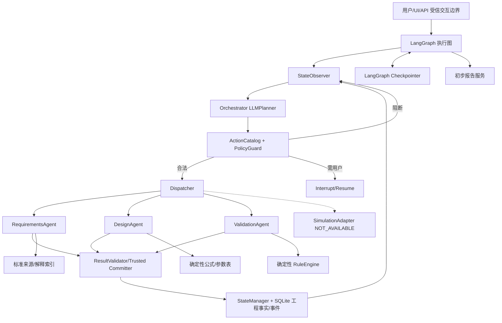

# 圆柱径向动压滑动轴承初步设计辅助系统——正式架构与实施总说明 V3.3

> **文档类型**：架构决策与工程实施基线；2026-10-24。基于上传的 V3.0 总说明、此前讨论形成的 V3.1/V3.2 设计决定、用户提供的外部 AI 评审意见，以及本次重新读取的 GitHub 当前核心模型文件整合。此处所有“计划”“接口草案”**不代表代码已实现**。若代码变化，以开始 PR 时实时核验的仓库事实为准。
>
> **配套执行文件**：`V3.3_四类核心协议冻结与迁移规范.md`、`V3.3_PR路线与双轨验收计划.md`、`V3.3_PR-02_Codex执行规格.md`。

## 0. 决议与版本边界

### 0.1 产品名称与可交付能力

**V1 产品名**：**面向圆柱径向动压滑动轴承的初步方案生成、规则预校核与可追溯交互系统**。远景研究课题可以称“滑动轴承多 Agent 辅助设计框架”，但不得把 V1 产品命名或报告包装为“已经完成自动轴承设计与性能验证”。

**V1 支持**：新设计；油润滑圆柱径向动压滑动轴承；单一明确稳态工况；主动追问、参数可信来源与确认、确定性基础工况派生计算、经审核规则支持的初步几何/材料/润滑候选、设计硬约束和已审核规则预校核、有限自动候选修订、人工接受关键方案、初步报告、任务中断恢复与审计。

**V1 不支持**：真实 DLAP、膜厚场/温度场/局部膜压求解与通过判定；瞬态、多工况谱及启停性能验证；可倾瓦/多油叶/推力/滚动轴承完整设计；无需人审的企业工程发布；无来源数字推荐、真实企业案例验证。仿真仅有 `SimulationAdapter` 接口和 `NOT_AVAILABLE` 结果。

**完成定义**：用户可以从模糊问题获得有针对性的追问，在明确的工况和批准的知识范围内形成一个可解释、可追溯的主候选；系统执行必需的确定性预检查，发现冲突则有限修订未确认变量，用户接受指定版本后输出明确列出未验证性能的报告。遇到不具备工程依据时，应正确停在 `REVIEW_REQUIRED`/`INSUFFICIENT_RULES`，而不是伪造完成。

### 0.2 已确认约束

- 已确认 **LangGraph** 是唯一的多 Agent 编排框架。采用框架提供的 checkpoint、interrupt/resume、上下文管理；不自研通用记忆，也不并列引入 Pi runtime。
- **四个实际运行的 Agent**：智能总控、需求引导、方案设计、预校核。知识/规则/计算/报告是共享服务；DLAP 为非运行适配接口。
- 自动修订仅限**未确认、已授权的候选设计变量**；固定工况、硬约束、已确认值只能形成待用户处理的变更提案；关键主候选由用户最终确认。
- 可以联系组内老师/研究生协助审核规则，但没有任何具体人员已签字的证据；数值规则仍按未审批处理。
- 目前没有真实/脱敏圆柱径向轴承案例；以明确标记的**合成工作流样例、标准参考算例、专家审核合成样例**分级建设；不得冒充真实企业案例。
- 发展顺序保留 PR-01→PR-02→PR-02B→PR-03→PR-04→PR-05→PR-06→PR-07→PR-08→PR-09；D0 标准审查与 PR-02 并行。

## 1. 本次“三轮评审”的审查结论（方案角色视角，非真实外部专家会签）

| 视角 | 审查问题 | 结论 | 行动 |
|---|---|---|---|
| 第一轮·轴承专业 | 无仿真与真实案例时能声称什么 | 必须缩紧 V1 产品与报告边界；预校核只判断所覆盖规则 | 修改产品名称、报告模板、标准审核分轨 |
| 第二轮·架构安全 | LLMPlanner 有多大权限、图状态如何恢复 | 动作提案与执行授权分离；领域 StateManager 唯一写入；业务效果幂等 | 冻结四组协议、依赖类型、执行守卫、重放机制 |
| 第三轮·研发科研 | 是否真正证明动态调度、PR 是否可执行 | FakePlanner 仅证明执行框架；PR-02B 要受控真实 LLM；PR-07 以客观进展评价修订 | 重订测试基线、迭代准则、实验记录和双轨验收 |

**判定**：外部建议中关于产品范围、依赖语义、用户事件、规则审核、业务幂等、模型实验可复现性与 Agent 数量的意见直接采纳；自动修订“目标函数一定改善”的表述**有条件采纳**，因为无 DLAP 时绝大多数性能目标不可测；不在 PR-02 建通用 DAG 调度/并行平台；四类协议冻结的是**语义和兼容契约**，不是锁死所有未来字段。

## 2. 系统全貌：区分三条流程

1. **工程任务 S0–S8（动态可回退）**：S0 类型识别→S1 需求澄清→S2 工况预分析→S3 规则策略→S4 候选设计→S5 预校核→S6 局部修订→S7 用户确认→S8 初步报告。它不是固定的 LangGraph Agent 链；面对新信息可跳回某一能力。
2. **一次智能决策循环（执行骨架稳定）**：Observe→LLM/Fake Planner→Guard→Dispatch→Validate→Trusted Commit→Observe/Stop/Wait。这里“动态”体现在条件影响下一能力和任务计划，而不是由大模型自由写任意图边。
3. **开发 PR 线（依赖推进）**：PR-01 领域基础；PR-02 LangGraph；PR-02B 真 Planner；PR-03 需求；PR-04 知识规则；PR-05 方案；PR-06 校核；PR-07 真闭环；PR-08 UI/报告；PR-09 对照实验。

### 2.1 文字架构图

`GraphState` 只保留设计/任务引用、检查点关联、近期规划/执行摘要；`DesignState` 是唯一工程事实来源。当前 `DesignState.task_plan` 已存在，作为任务记录真相；不要再建第二张可写任务计划。业务写入只经过现有 `StateManager`，Agent 可以提交提案，不能升级自己的写入权限。

### 2.2 智能总控必须可验证的能力

- **状态感知**：理解当前目标、缺口、约束、候选版本、失败 issue、哪些工具可用、是否有待确认对象与剩余预算。
- **有限任务规划**：建立/更新 1–3 个近期可执行任务和前置依赖；允许重规划，记录 `reason_for_replan` 和计划/状态版本。
- **行动选择**：只从经过 `ActionCatalog` 筛选的动作中选择，并输出结构化 `PlanDecision`。简单只读工具可以按成本和条件直接运行；Guard 对所有领域写入统一把关。
- **失败恢复**：能区分资料不足、规则冲突、工具异常、被拒和版本失效；不能通过盲目重复相同动作假装重新规划。
- **局部重规划**：输入变化时，依赖追踪器判定受影响任务/结果；早期无精确依赖时采取保守失效而不是遗漏失效。
- **可解释追溯**：记录行动候选、选择理由摘要、Guard 结果、写入事件、预算和终止理由；不依赖保存大模型内部推理链。

**安全策略优先级**：受信执行边界和软件硬规则 > 已确认工程约束及审核适用性 > 用户在允许范围内的选择 > LLMPlanner 建议。总控不能修改真实用户来源、确认状态或标准审批状态。

## 3. 三个专业 Agent 的接口边界

| Agent | 输入 | 应做 | 不应做 | 产物 |
|---|---|---|---|---|
| RequirementsAgent | 用户原话和 ID、权威状态、参数字典、可用知识 | 识别任务范围、抽取参数、分类固定输入与设计变量、对冲突/缺失动态追问 | 自称源消息是用户、对缺 F 编数值、替用户确认 | `RequirementProposal`、问题列表、证据定位 |
| DesignAgent | 经核验 RequirementSpec、规则/表/材料油品查询、候选历史 | 算 v、已知 B 后算 p_m；提出有依据的 B/间隙/材料/润滑候选；修订未确认变量 | 把 ISO 草案当批准限值、虚构完整油品黏温曲线、给出 DLAP 膜厚温度结果 | `ConditionAnalysis`、`DesignStrategy`、`DesignProposal`、`RevisionProposal` |
| ValidationAgent | 候选版本、当前输入、审核规则、覆盖要求 | 调确定性规则判断 PASS/FAIL；提供违规项/原因/建议 | 自行宣布工程通过、在未审核/空规则时形成正式 PASS | `PrecheckResult`、`Issue`、修订建议 |

**重要物理限定**：速度 `v=πDn/60`（D 用 m，n 用 r/min）；平均投影比压 `p_m=F/(DB)`（F 用 N，D/B 用 m）。比压不是局部油膜最大压力；没有真实稳态求解结果就没有最小膜厚/最高温度/局部压力的工程结论。

## 4. 需求就绪、方案就绪、规则覆盖必须分开

| 门槛 | 精确定义 | 未满足时的合法动作 |
|---|---|---|
| `R1` / 部分输入可分析 | 可执行某个派生公式的必要输入真实存在 | 计算可得指标、提示缺口 |
| `INPUT_READY` ≈ 当前代码 `R2` | 有规范化 D/F/n、明确且适用的一个稳态 OperatingCase，来源和单位可查 | 继续工况预分析；不可因此直接推荐完整方案 |
| `STRATEGY_READY` | 关键候选设计参数有已确认用户输入或**已审核适用**策略 | 可输出有来源的方案建议 |
| `CANDIDATE_READY` | 该初步方案必需字段齐全，无越权值，输入版本有效 | 进入规则预校核 |
| `PRECHECK_COVERED` | 本次 `RuleCoverageSpec` 规定的所有**适用必检规则**均有有效结果 | 依据结果呈现 `PRECHECK_PASS`/FAIL/REVIEW |
| `R3` | 已满足某个真实 DLAP 模型输入条件 | V1 禁用，永远不能以软件演示替代 |

这些是从权威状态、来源和策略 **派生**的条件，不另建一套可写“就绪状态数据库”。缺少批准材料数据或宽度推荐依据时可展示 `PARTIAL_CANDIDATE`（作为视图/错误原因，不要求新增 PR-01 状态枚举），但不能签发“可预校核的完整方案”。

## 5. 用户交互与工程可信证据

**从 PR-02 前冻结最小用户交互语义；真正的多轮语义实现放 PR-03，真实 UI 放 PR-08。** 所有用户事件须绑定 `event_id`, `design_id`, `actor`, `received_at`, `source_message_id`, `target_kind`, `target_id`, `target_revision`, `expected_domain_version`（部分类型可选），并有可信交互边界颁发的来源证明。`WriteContext(USER)` 只能由经验证的服务端创建；不能依据 Agent 输出或前端任意指定角色创建。

| 交互对象/事件 | 语义 | 权威状态变化 |
|---|---|---|
| `UserTurn` | 用户原始发言/附件引用，绑定原文证据 | 原文持久存储；不自动令任意抽取值 CONFIRMED |
| `UserCorrection` | 对特定字段提出修正，引用旧 revision 和新证据 | 经权限和版本检查后更新，并使相关结果 STALE |
| `UserConfirmation` | 接受某参数/候选 **指定版本** 及已展示的未验证范围 | 只对该对象有效；旧版本不可重用 |
| `UserRejection` | 拒绝特定参数建议、变更提案或候选 | 对拒绝对象记审计事件；不覆盖现行值 |
| `ParameterChangeProposal` | Agent 或用户提出改变已确认值的建议 | 复用 PR-01 模型，等待合法用户决议 |
| `ConfirmationExpired` | 请求的目标/版本/关键依赖已变化 | 旧确认请求不能提交；需要刷新展示并重新授权 |

**真实性分离**：有用户原文 ≠ 用户确认值 ≠ 来源图纸/轴系计算得到工程验证值 ≠ 标准规则通过专家审核。V1 可接受明确用户声明用于带前提的初步设计，但猜测载荷须保留不确定性，不能隐去风险。

PR-02 冻结协议+用假用户操作测试身份/恢复；PR-03 CLI 完成多轮纠错/拒绝/追问；PR-07 完成自动修订与用户拒绝链；PR-08 将其映射成真实 UI/API。见配套《四类核心协议冻结与迁移规范》。

## 6. 专业规则与标准审查体系

规则按四类分流：`SourceCatalog`（原始资料编号/版本/许可）→ `KnowledgeIndex`（解释性文字/前提）/`RuleRepository`（可执行条件）/`EngineeringTableRepository`（结构化数表）/`ScenarioRepository`（标准算例及测试）。不要把标准全文嵌入每个 Agent 上下文或将所有文字转成 YAML。

**来源优先级**：07 圆柱动压计算原理→适用范围与假设；09 许用参数→间隙比表、材料许用平均比压等审查候选；08 密集特性数据表仅在明确计算需求后入库；10–13 多油叶/可倾瓦延后。标准草案与参考 ISO 的正式版本和许可尚须核对，不得直接当 `ACTIVE`。模型语境与参数单位必须留存，尤其径向/直径间隙及平均/局部压力区分。

**审批状态**：`DRAFT_EXTRACTED → SOURCE_CHECKED → EXPERT_APPROVED → ACTIVE`。某规则即便曾经 ACTIVE，版本变化后依赖旧版本的 `PRECHECK_PASS` 仍必须 STALE。`DEMO_ONLY` 仅供软件测试，绝不生成正式工程通过证明。

**RuleCoverageSpec** 决定本轮适用的必检集合，如已确认的安装宽度、允许材料、来源约束合法性等；专业数值限制在审核后才成为必检或条件项。**空集或覆盖无效不允许总预校核 PASS**。返回逐项判定、未评价的性能项、规则/参数/候选版本；规则与用户硬约束冲突时 `REVIEW_REQUIRED`，不可自动选择更松阈值。

**D0 专家审核任务**：联系组内教师/研究生；提供标准编号版次、条款图表、符号/单位、输入边界、示例、例外和拟定的软件谓词；审核人明示 `APPROVE/REVISE/REJECT/NOT_IN_SCOPE` 并记录。当前只是“能联系”，不代表已经有通过的审核结果。工程轨可以 `DOMAIN_PENDING` 而软件轨继续。

## 7. 自动修订：有限且客观的反馈闭环

### 7.1 可变对象与权限

- 可以改：**候选空间中未确认**且在规则和用户允许范围内的 `DESIGN_VARIABLE`，如 B/间隙的候选值。每次创建新候选版本，不覆盖旧方案。
- 不可以直接改：固定 D/F/n、已确认 B、安装空间硬约束、材料允许列表、标准规则阈值。需要用户变更提案或规则重新审核。
- 控制：原型默认每个问题族最多 **3 次**尝试；总循环再设预算、无进展计数与人工升级。次数是软件配置，不是轴承物理规律。

### 7.2 选择次序（lexicographic，不使用 LLM 自评“更好”）

1. **合法性门槛**：权限、来源、状态版本、已有硬约束和规则适用性未通过的修订，直接拒绝。
2. **可行性优先**：确定性执行所有当前适用的必检规则，不出现新增更高风险失败；按预先定义的风险层级/违约向量比较改进（对缺数据/未评价项不假设通过）。
3. **已声明且可测的用户偏好**：只能比较 V1 可客观计算或具有批准规则评价的量。例如“尽可能少修改”和“满足安装空间”；不能臆造摩擦损耗、膜厚或温度函数。
4. **修改范围最小**：在满足前面的条件时，优先更少受影响变量、更小偏离已建议值、更少重新计算成本，规则需确定且可复算。
5. **不确定或相互不可比较时**：保留多个有来源候选摘要，交用户/专家决定，不用自然语言解释冒充数值证据。

### 7.3 “有进展”必须可计算

设当前失败的已执行必检约束集合为 `F_old`，新结果为 `F_new`，并对每项有可计算的违约幅度（例如超出安装宽度限制的 mm 数）。若 `F_new` 严格减少且没有新增其他已检查硬约束失败，或在相同失败集合上预定义违约向量**严格改善且无重要项恶化**，判为进展；对无法比较的量记 `UNKNOWN` 并进入审核/寻求更多数据，不宣布改善。只有当客观用户偏好指标确实存在时，才在**可行方案之间**比较其变化（带单位和容差）。

修订不会自动优化摩擦损耗、油温或膜厚，因为 V1 无这些性能输出。对无进展、规则缺失或预算耗尽，输出明确的 `NO_PROGRESS / REVIEW_REQUIRED / BUDGET_EXHAUSTED` 执行原因并停止。

### 7.4 例子

候选 `B=70mm`，用户安装宽度上限 `65mm`，且 B 未确认。存在经审核的允许 B 区间时，DesignAgent 可生成新版 `B=62mm`（**只作为说明修订行为的合成示例值，非工程推荐**）。RuleEngine 对已覆盖几何项重新检查。此时“几何规则冲突消除”可被认作进展，但**不代表**膜厚、温度或轴承承载性能合格；若已确认 B 则必须暂停进入人工变更流程。

## 8. 状态、依赖、恢复与写入一致性

### 8.1 必须在 PR-02 固化的两种依赖

**现有代码事实（已读取）**：`TaskRecord.dependencies: list[str]`；`DependencyTracker.invalidate_dependents()` 使用 `changed_fields & set(task.dependencies)` 判断任务失效，意味着当前行为是“输入字段依赖”。把任务 ID 直接塞进该字段会错误失效。

**V3.3 兼容规则**：`depends_on_task_ids` = 前置任务拓扑；`consumed_input_refs` = 参数/约束/OperatingCase/规则版本的实际读取依赖。PR-02 必须明确这两个语义并写兼容迁移/测试；**若不能安全改既有字段，至少保留 `dependencies` 为旧输入依赖别名并不允许任务 ID 混入**。精确字段级快照在 PR-07 完成，在此之前保守失效，不能漏掉旧结果过期。

状态来源：`DesignState.task_plan` 是唯一已持久化任务记录；`GraphState` 不复制一份可写任务计划或 `parameters`。受信写入路径复用 PR-01 的 StateManager/CAS/事件历史；需要补的是跨 checkpoint 重试的**业务效果幂等**，不是跨 SQLite/Graph checkpoint 的全局 exactly-once 事务。

### 8.2 幂等恢复协议

所有有领域副作用的操作绑定稳定 `operation_id`、`task_id`、输入版本与 effect 类别。`StateManager/Repository` 在**同一个业务 SQLite 事务**中执行 version CAS、operation 去重和结果/事件写入；重复调用返回已记录的业务结果或明示 `ALREADY_APPLIED`，不再增加候选/确认/审计事件。Graph 恢复先重查业务库，再决定恢复/重规划。

- `interrupt()` 的确认节点将请求对象 ID、候选版本、已展示的必需依赖摘要作为 payload。恢复之后检查当前版本/依赖；失效则 `ConfirmationExpired`，不实施旧确认。
- 禁止在 `interrupt()` 前做不可幂等的 append/创建行为；无法避免则用 `operation_id` 和独立节点隔离副作用。
- 恢复演示必须覆盖：DB 已写而 Graph checkpoint 未记录；同一用户确认重复提交；等待期间设计状态被另一请求修改；输入过期导致任务不执行。
- V1 单设计会话只允许一个活动写入执行序列（串行），多只读动作按需；无需分布式事务框架/并行写队列。

## 9. LLMPlanner：研究对象与复现实验

PR-02 的 `FakePlanner` 只证明受控执行骨架，不代表 LLM 智能。PR-02B 必须调用至少一个真实模型对多种状态生成结构化动作计划，记录 `model_provider`, `model_identifier`、**提供方可见的模型版本（若不可得须注明）**、`prompt_hash/version`、`schema_version`、`action_catalog_version`、`guard_policy_version`、采样参数、工具/检索版本、重试次数、token、成本估算方式、延迟、判定和原始结构化输出。无模型密钥 CI 只跑 fake/deterministic 测试；不能用 FakeLLM 冒充真实模型试验。

模型适配使用 `create_agent`/结构化输出时，返回的数据仍必须经过 Pydantic 和 Guard；provider-native structured output 和 tool strategy 按实际模型支持选择。记录提示词和模型配置不等于公布敏感 token/个人数据。真实响应可能随机，同一模型下多次运行后报告均值、波动和失败，避免一次演示推断普适性能。

### 9.1 三种对照组与公平性

`A 单 Agent`、`B 固定阶段多 Agent`、`C 状态感知动态总控`，控制输入任务/规则来源/可用工具/所用基础模型及提示词级别的总工作量；分别报告**成功完成率**和**正确阻断率**，不可两项简单相加称完成率。比较用户追问轮数、重复调用、合法动作比例、硬约束违规通过、局部失效准确率、费用/延迟与可追溯覆盖率。

**数据集分层**：`SYNTHETIC_WORKFLOW` 证明工作流；`STANDARD_REFERENCE` 证明参考算例计算复核；`EXPERT_REVIEWED_SYNTHETIC` 证明特定规则和案例得到技术审核。训练/提示词调试场景与最终评估案例分开，避免泄漏。无真实企业案例和 DLAP 时，不评价真实工程服役成功率。

## 10. 测试、验收和安全红线

**必须通过的安全不变量**：Agent 不能写 USER 来源或已确认参数；不能伪造候选 `PRECHECK_PASS`；不能空规则 PASS；用户硬约束不能自动放松；旧规则/输入版本使校核 STALE；修订不会因无进展无限循环；仿真永远显式不可用；恢复不能重复产生领域效果。

**三层证据**：L1 软件质量（pytest/ruff/安装和离线回归）；L2 行为与流程（正反例、故障注入、确认与动态路径）；L3 专业证据（规则来源/审核、算例复算、指定范围初步推荐）。推荐每个 PR 分别标记 `SOFTWARE_ACCEPTED`、`DOMAIN_PENDING/DOMAIN_ACCEPTED/NOT_APPLICABLE`。没有真正审核记录时不得写 `DOMAIN_ACCEPTED`。

**异常结果不得伪装成功**：技术任务执行成功≠工程判定通过；`PrecheckStatus.NOT_EVALUATED`≠`SimulationStatus.NOT_AVAILABLE`；`REVIEW_REQUIRED`≠`PRECHECK_FAIL`；用不同类型和报表标题准确表达。四类协议的具体矩阵见配套文件。

**来源安全与版权**：未获授权的 ISO 全文/整表不复制到公开 GitHub；按编号、版次、条款和经许可的摘录引用；外部文档内容视为非受信数据，不得其中的指令改变工具权限。

## 11. 研发里程碑与项目门禁

| 项目门禁 | 实现 PR | 必须证明 |
|---|---|---|
| Gate A：可恢复受控执行 | PR-02 | 多状态选择动作、Guard 拒绝、重复副作用不写、任务依赖语义分离 |
| Gate B：真实智能决策与可信输入 | PR-02B/03 | 真 LLM 状态敏感计划；来源可核验的多轮输入/纠错/拒绝 |
| Gate C：专业依据与候选 | PR-04/05 | 审核流程、覆盖表、已审规则支持的参数或诚实部分候选 |
| Gate D：专业预校核闭环 | PR-06/07 | 非空必检集合；有限自动修订、版本失效、局部重规划；不夸大性能 |
| Gate E：真实用户与实验 | PR-08/09 | 初级用户 UI 从一句话到报告；可复现的公平对照实验 |

**当前下一工作**：启动 PR-02；同步进行 D0（标准条款和合成案例准备）。完整 PR 步骤与验收矩阵见配套路线文件。

## 12. 版本管理和正式生效

- 本 V3.3 是后续规格的建议**冻结基线**，以用户确认和提交仓库文档后生效；本次仅生成文件，不改动仓库。
- 本文对 V3.0–V3.2 的关键补充：产品准确定位；四类协议语义；任务/字段依赖分离；业务幂等；RuleCoverage；客观自动修订准则；真实 LLM 可复现实验；规则审核与合成案例证据分级。
- 对于已存在的 PR-01 参数/候选/任务模型，新增字段以**最小向后兼容**为原则；如修改会破坏旧存储，附迁移脚本与回归证明，不能隐式改动老数据含义。
- 项目负责人负责组织领域审核与统一决策；Codex 按 PR 规格修改、测试、提交；架构审核者按可执行证据逐项审查，而不是按主观“看起来合理”通过。
